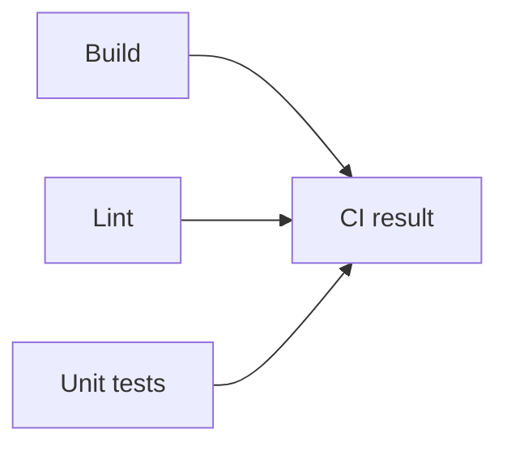
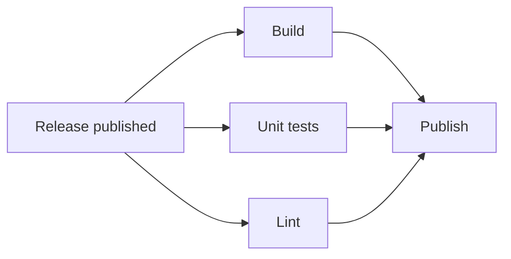

# ratelimiter

[](https://github.com/rr-saberov/ratelimiter/actions/workflows/ci.yml)
[](https://github.com/rr-saberov/ratelimiter/actions/workflows/cd.yml)

A small Go HTTP service demonstrating CI/CD with GitHub Actions.
It limits requests per client IP using a token bucket, with no third-party runtime dependencies.

Repository: [rr-saberov/ratelimiter](https://github.com/rr-saberov/ratelimiter).

## Run locally

Requires Go 1.26 or newer. From the repository root:

```sh
go run ./cmd/ratelimiter
```

In another terminal:

```sh
curl -i localhost:8080/
```

`GET /` returns `200 OK` while the client has tokens, or `429 Too Many Requests`
with a `Retry-After` header when the bucket is empty. Each client starts with five
tokens and regains one per second, up to the capacity.

To change the defaults:

```sh
go run ./cmd/ratelimiter -addr :8080 -capacity 20 -refill 250ms
```

Client buckets live in memory without eviction and are not shared between instances.
Clients are identified by the TCP peer IP; `X-Forwarded-For` is ignored.

## Build and test

```sh
go build ./...
go test -race -count=1 -timeout=5m ./...
```

Optional [Task](https://taskfile.dev) shortcuts are listed in [Taskfile.yml](Taskfile.yml).
For local linting, run `golangci-lint run` with version v2.13.2, as used in CI and CD.

## Workflows

**[CI](.github/workflows/ci.yml)** runs on every push to `main` with three parallel jobs:
`Build` compiles all packages, `Unit tests` runs tests with race detection, and `Lint` runs
golangci-lint. Each job checks out the code and sets up Go, with its own status and logs
in the GitHub Actions UI. Steps within each job run sequentially.
The final `CI result` job collects all three results and fails if any check failed,
was cancelled, or was skipped.



**[CD](.github/workflows/cd.yml)** runs when a GitHub Release is published manually.
`Build`, `Unit tests`, and `Lint` run in parallel against the release commit. `Build` produces
one Linux amd64 binary and stores it as a workflow artifact. `Publish` downloads that
binary and attaches it to the release only after all three jobs succeed.



Separate jobs make failures easier to locate and allow independent reruns; parallel
checks can shorten feedback time. The tradeoff is repeated checkout and Go setup,
more runner time, and artifact transfer between build and publication. A failed check
does not stop the other independent checks, but it blocks `Publish`.

To try CD, open **Releases → Draft a new release**, choose a new tag such as `v1.2.3`,
and click **Publish release**. Once CD succeeds, download `ratelimiter_linux_amd64`
from the release assets. On Linux amd64:

```sh
chmod +x ratelimiter_linux_amd64
./ratelimiter_linux_amd64
```

The workflow uses the [`release: published` event](https://docs.github.com/en/actions/reference/workflows-and-actions/events-that-trigger-workflows#release),
so saving a draft does not trigger it. Keep immutable releases disabled because CD
attaches the binary after publication.

## Marketplace actions

| Action | Purpose |
| --- | --- |
| [actions/checkout](https://github.com/marketplace/actions/checkout) | Check out the project code |
| [actions/setup-go](https://github.com/marketplace/actions/setup-go-environment) | Install the Go version from `go.mod` |
| [golangci/golangci-lint-action](https://github.com/marketplace/actions/run-golangci-lint) | Lint the code in CI and CD |
| [actions/upload-artifact](https://github.com/marketplace/actions/upload-a-build-artifact) | Store the CD build output for publication |
| [actions/download-artifact](https://github.com/marketplace/actions/download-a-build-artifact) | Retrieve the binary in the publication job |
| [softprops/action-gh-release](https://github.com/marketplace/actions/gh-release) | Attach the binary to the GitHub Release |

Actions are pinned to commit SHAs, with version comments for readability.

## License

[MIT](LICENSE)
