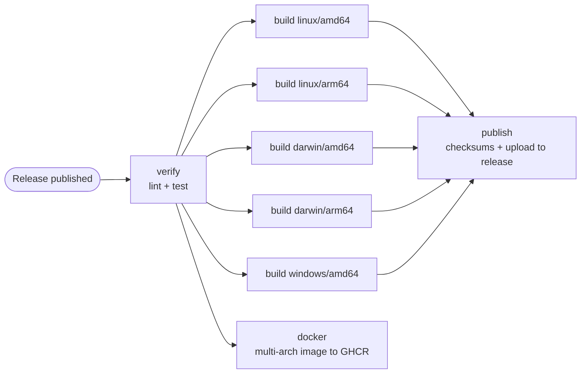

# ratelimiter

[](https://github.com/rr-saberov/ratelimiter/actions/workflows/ci.yml)
[](https://github.com/rr-saberov/ratelimiter/actions/workflows/cd.yml)
[](go.mod)
[](LICENSE)

A small Go HTTP service that rate-limits requests per client with a **token bucket**.
It exists to demonstrate two GitHub Actions workflows on a real, tested Go project:

- **CI** — every push to `main` is built, tested, and packaged into a Docker image that is smoke-tested.
- **CD** — publishing a GitHub Release lints, tests, cross-compiles the binary for five OS/architecture
  targets, attaches the binaries plus a checksum file to that release, and pushes a multi-arch Docker
  image to GitHub Container Registry.

The project has no third-party dependencies and was written test-first.

## The Go project

### What it does

The server exposes a single endpoint, `GET /`. Each client (keyed by IP address) gets a token bucket:

- the bucket starts full with `capacity` tokens and every request consumes one;
- one token is put back every `refill` interval, never exceeding `capacity`;
- a full bucket does not bank partial refill progress, so a client that was idle cannot exceed the burst;
- when the bucket is empty the server answers `429 Too Many Requests` with a `Retry-After` header
  (seconds, rounded up) telling the client when the next token becomes available.

```
$ ./ratelimiter -addr :8080 -capacity 5 -refill 1s
time=... level=INFO msg=listening address=:8080 capacity=5 refill_every=1s version=v1.1.0

$ for i in 1 2 3 4 5 6; do curl -s -o /dev/null -w '%{http_code}\n' localhost:8080/; done
200
200
200
200
200
429

$ curl -i localhost:8080/
HTTP/1.1 429 Too Many Requests
Content-Type: text/plain; charset=utf-8
Retry-After: 1
X-Content-Type-Options: nosniff
```

| Flag        | Default | Meaning                                                   |
|-------------|---------|-----------------------------------------------------------|
| `-addr`     | `:8080` | Address to listen on                                      |
| `-capacity` | `5`     | Maximum burst of requests allowed per client              |
| `-refill`   | `1s`    | Interval at which one request is granted back per client  |
| `-version`  |         | Print the version baked in at build time and exit         |

The server shuts down gracefully on `SIGINT`/`SIGTERM`.

### Running it from Docker

```sh
docker run --rm -p 8080:8080 ghcr.io/rr-saberov/ratelimiter:latest
docker run --rm -p 8080:8080 ghcr.io/rr-saberov/ratelimiter:1.1.0 -capacity 20 -refill 250ms
```

Images are published for `linux/amd64` and `linux/arm64`, tagged with the full version (`1.1.0`),
the minor version (`1.1`), and `latest`. The `Dockerfile` is a two-stage build: the Go toolchain
compiles a static binary on the build platform (cross-compiling for the target, so no emulation is
needed), and the runtime stage is `distroless/static` running as a non-root user, about 8 MB in total.

### Layout

```
.
├── .github/
│   ├── dependabot.yml       weekly updates for Actions and Go modules
│   └── workflows/
│       ├── ci.yml           Phase 1: continuous integration
│       └── cd.yml           Phase 2: continuous delivery
├── cmd/ratelimiter/         entry point: flag parsing, HTTP server, graceful shutdown
├── internal/httpapi/        handler and rate-limiting middleware (429 + Retry-After)
├── ratelimit/               token bucket and per-key limiter (importable library)
├── .golangci.yml            golangci-lint v2 configuration used by the CD workflow
├── Dockerfile               multi-stage, multi-arch image (distroless, non-root)
└── Taskfile.yml             the same commands the workflows run, via Task
```

`ratelimit` is the core. `Bucket` is a mutex-guarded token bucket with an injected clock
(`func() time.Time`), which makes every timing scenario deterministic in tests. `Limiter` keeps one bucket
per key. The HTTP layer depends only on a two-method interface (`Allow`, `RetryAfter`), so it is tested
against the real limiter with a fixed clock instead of mocks.

Deliberate simplifications for a demo: buckets live in memory and are never evicted, the limiter is not
shared between instances, and the client key is taken from the TCP peer address rather than
`X-Forwarded-For`.

### Local development

Commands live in `Taskfile.yml` and run with [Task](https://taskfile.dev) (`brew install go-task`);
`task --list` shows them all.

```sh
task test                  # go test -race -count=1 ./...
task lint                  # golangci-lint run  (v2.x; the CD workflow pins v2.13.2)
task build                 # CGO_ENABLED=0 go build -trimpath -ldflags "-s -w -X main.version=dev" -o ratelimiter ./cmd/ratelimiter
task build VERSION=v1.2.3  # same, with that version baked in
task run                   # build, then start the server with default flags
task docker                # docker build --build-arg VERSION=dev -t ratelimiter:dev .
task clean                 # remove the binary, coverage output and dist/
```

## Workflows

### Phase 1 — CI (`.github/workflows/ci.yml`)

**Trigger:** every push to `main`. Pull requests targeting `main` and manual runs (`workflow_dispatch`)
run the same jobs, so a change is verified before it lands and can be re-run on demand.

**Job `verify`** (`ubuntu-latest`):

1. `actions/checkout` — check out the commit.
2. `actions/setup-go` — install the Go version declared in `go.mod` (`go-version-file`) and restore the
   module/build cache, so the workflow never drifts from the version developers use locally.
3. `go build ./...` — compile every package.
4. `go test -race -count=1 ./...` — run all tests with the race detector, without the test cache.

**Job `docker`** (runs after `verify`):

1. `docker/setup-buildx-action` — a BuildKit builder with GitHub Actions cache support.
2. `docker/build-push-action` — build the image from the `Dockerfile` with `VERSION=<commit sha>`,
   load it into the local daemon, and keep layers in the Actions cache (`type=gha`). Nothing is pushed.
3. Smoke test — run the container with `-version` and assert it prints the commit SHA, which proves the
   image starts, the entrypoint works as the non-root user, and the build argument reached the binary.

**Details worth noting:**

- `permissions: contents: read` — the workflow gets a read-only token; CI never needs more.
- `concurrency` — superseded runs of the same pull request are cancelled; runs on `main` are never
  cancelled so every commit on `main` keeps its own result.
- `timeout-minutes: 10` — a hung job cannot burn runner minutes.

### Phase 2 — CD (`.github/workflows/cd.yml`)

**Trigger:** `release` with type `published`, i.e. the moment a GitHub Release is created manually
(UI or `gh release create`) and made public. `published` is used instead of `created` because `created`
also fires for draft releases, whose git tag does not exist yet, so nothing could be checked out or built.



**Jobs:**

1. **verify** — `actions/checkout`, `actions/setup-go`, then `golangci/golangci-lint-action` runs
   golangci-lint v2.13.2 with the repository's `.golangci.yml`, and `go test -race -count=1 ./...`
   runs the test suite. A release with lint errors or failing tests never gets binaries or an image.
2. **build** — a matrix job, one runner per target (`linux/amd64`, `linux/arm64`, `darwin/amd64`,
   `darwin/arm64`, `windows/amd64`). Each runs `go build` with `CGO_ENABLED=0` (static binaries),
   `-trimpath -ldflags "-s -w"` (reproducible and small) and `-X main.version=<tag>` so
   `ratelimiter -version` prints the release tag. Binaries are named
   `ratelimiter_<tag>_<os>_<arch>` (`.exe` on Windows) and handed to the next job with
   `actions/upload-artifact`.
3. **docker** — runs in parallel with the matrix. `docker/login-action` authenticates to `ghcr.io`
   with the workflow's own `GITHUB_TOKEN`, `docker/metadata-action` derives the image tags from the
   release tag (`1.1.0`, `1.1`, `latest`) plus OCI labels, and `docker/build-push-action` builds
   `linux/amd64` and `linux/arm64` in one manifest list and pushes it. This is the only job with
   `packages: write`.
4. **publish** — the only job with `contents: write`. It collects the five binaries with
   `actions/download-artifact`, writes `ratelimiter_<tag>_checksums.txt` (SHA-256), and
   `softprops/action-gh-release` attaches all six files to the release that triggered the run
   (`fail_on_unmatched_files` guards against an empty upload). The job summary lists the assets.

The workflow-level token is read-only; each job is elevated only for what it does. Every job has a
timeout, and the release tag is passed to shell steps through an environment variable rather than
interpolated into the script.

The workflow attaches assets to an already published release, which requires the repository's
"immutable releases" setting to stay off (the GitHub default). With immutability on, assets would have to be
attached to a draft release and the draft published afterwards.

**Cutting a release:**

```sh
gh release create v1.1.0 --generate-notes      # or use the "Draft a new release" button on GitHub
gh run watch                                   # optional: follow the CD run
gh release download v1.1.0 -p 'ratelimiter_v1.1.0_darwin_arm64' -p '*checksums.txt'
shasum -a 256 --ignore-missing -c ratelimiter_v1.1.0_checksums.txt   # sha256sum on Linux
chmod +x ratelimiter_v1.1.0_darwin_arm64 && ./ratelimiter_v1.1.0_darwin_arm64 -version
docker run --rm ghcr.io/rr-saberov/ratelimiter:1.1.0 -version
```

### GitHub Marketplace actions used

| Action                                                                                  | Version | Used in | Purpose                                                        |
|-----------------------------------------------------------------------------------------|---------|---------|----------------------------------------------------------------|
| [actions/checkout](https://github.com/marketplace/actions/checkout)                     | v7      | CI, CD  | Check out the repository                                       |
| [actions/setup-go](https://github.com/marketplace/actions/setup-go-environment)         | v7      | CI, CD  | Install Go from `go.mod`, cache modules and build outputs      |
| [golangci/golangci-lint-action](https://github.com/marketplace/actions/run-golangci-lint) | v9    | CD      | Install and run golangci-lint v2.13.2                          |
| [actions/upload-artifact](https://github.com/marketplace/actions/upload-a-build-artifact) | v7    | CD      | Pass each matrix build's binary to the publish job             |
| [actions/download-artifact](https://github.com/marketplace/actions/download-a-build-artifact) | v8 | CD      | Collect all binaries into one directory                        |
| [softprops/action-gh-release](https://github.com/marketplace/actions/gh-release)        | v3      | CD      | Attach binaries and checksums to the GitHub Release            |
| [docker/setup-buildx-action](https://github.com/marketplace/actions/docker-setup-buildx) | v4     | CI, CD  | BuildKit builder with multi-platform and cache support         |
| [docker/build-push-action](https://github.com/marketplace/actions/build-and-push-docker-images) | v7 | CI, CD | Build the image (CI) and build + push the multi-arch image (CD) |
| [docker/login-action](https://github.com/marketplace/actions/docker-login)              | v4      | CD      | Log in to `ghcr.io` with `GITHUB_TOKEN`                        |
| [docker/metadata-action](https://github.com/marketplace/actions/docker-metadata-action) | v6      | CD      | Derive image tags and OCI labels from the release tag          |

Dependabot (`.github/dependabot.yml`) opens weekly pull requests when any of these actions, or a Go
module, has a newer version.

## License

[MIT](LICENSE)
