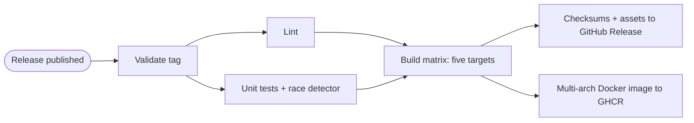

# ratelimiter

[](https://github.com/rr-saberov/ratelimiter/actions/workflows/ci.yml)
[](https://github.com/rr-saberov/ratelimiter/actions/workflows/cd.yml)
[](go.mod)
[](LICENSE)

A small Go HTTP service that rate-limits requests per client with a **token bucket**.
It exists to demonstrate two GitHub Actions workflows on a real, tested Go project:

- **CI** — every push to `main` is built, linted, tested, and packaged into a Docker image that is smoke-tested.
- **CD** — publishing a GitHub Release lints, tests, cross-compiles the binary for five OS/architecture
  targets, attaches the binaries plus a checksum file to that release, and pushes a multi-arch Docker
  image to GitHub Container Registry.

The project has no third-party runtime dependencies.

Public repository: [github.com/rr-saberov/ratelimiter](https://github.com/rr-saberov/ratelimiter).

## The Go project

### What it does

The server exposes a single endpoint, `GET /`. Each client (keyed by IP address) gets a token bucket:

- the bucket starts full with `capacity` tokens and every request consumes one;
- one token is put back every `refill` interval, never exceeding `capacity`;
- a full bucket does not bank partial refill progress, so a client that was idle cannot exceed the burst;
- when the bucket is empty the server answers `429 Too Many Requests` with a `Retry-After` header
  (seconds, rounded up) telling the client when the next token becomes available.

```
$ ./ratelimiter -addr :8080 -capacity 5 -refill 1s
time=... level=INFO msg=listening address=:8080 capacity=5 refill_every=1s version=v1.1.0

$ for i in 1 2 3 4 5 6; do curl -s -o /dev/null -w '%{http_code}\n' localhost:8080/; done
200
200
200
200
200
429

$ curl -i localhost:8080/
HTTP/1.1 429 Too Many Requests
Content-Type: text/plain; charset=utf-8
Retry-After: 1
X-Content-Type-Options: nosniff
```

| Flag        | Default | Meaning                                                   |
|-------------|---------|-----------------------------------------------------------|
| `-addr`     | `:8080` | Address to listen on                                      |
| `-capacity` | `5`     | Maximum burst of requests allowed per client              |
| `-refill`   | `1s`    | Interval at which one request is granted back per client  |
| `-version`  |         | Print the version baked in at build time and exit         |

The server shuts down gracefully on `SIGINT`/`SIGTERM`.

### Running it from Docker

```sh
docker run --rm -p 8080:8080 ghcr.io/rr-saberov/ratelimiter:latest
docker run --rm -p 8080:8080 ghcr.io/rr-saberov/ratelimiter:1.1.0 -capacity 20 -refill 250ms
```

Images are published for `linux/amd64` and `linux/arm64`. Stable `vMAJOR.MINOR.PATCH` releases
get the git tag (`v1.1.0`), full version (`1.1.0`), minor version (`1.1`), and `latest`.
Prereleases get their own version tags and never update `latest` or a minor alias, even when
the git tag looks stable but the GitHub Release is marked as a prerelease. Other tag names
get a tag derived from the git ref. Shared aliases follow publication order; publish stable
versions in increasing order if consumers rely on `latest`.
The `Dockerfile` is a two-stage build: the Go toolchain
compiles a static binary on the build platform (cross-compiling for the target, so no emulation is
needed), and the runtime stage is `distroless/static` running as a non-root user, about 8 MB in total.

### Layout

```
.
├── .github/
│   ├── dependabot.yml       weekly updates for Actions and Go modules
│   ├── scripts/             Docker HTTP and shutdown smoke test
│   └── workflows/
│       ├── ci.yml           Phase 1: continuous integration
│       └── cd.yml           Phase 2: continuous delivery
├── cmd/ratelimiter/         entry point: flag parsing, HTTP server, graceful shutdown
├── internal/httpapi/        handler and rate-limiting middleware (429 + Retry-After)
├── ratelimit/               token bucket and per-key limiter (importable library)
├── .golangci.yml            golangci-lint v2 configuration used by CI and CD
├── Dockerfile               multi-stage, multi-arch image (distroless, non-root)
└── Taskfile.yml             the same commands the workflows run, via Task
```

`ratelimit` is the core. `Bucket` is a mutex-guarded token bucket with an injected clock
(`func() time.Time`), which makes every timing scenario deterministic in tests. `Limiter` keeps one bucket
per key. The HTTP layer depends only on a two-method interface (`Allow`, `RetryAfter`), so it is tested
against the real limiter with a fixed clock instead of mocks.

Deliberate simplifications for a demo: buckets live in memory and are never evicted, the limiter is not
shared between instances, and the client key is taken from the TCP peer address rather than
`X-Forwarded-For`.

### Local development

Commands live in `Taskfile.yml` and run with [Task](https://taskfile.dev) (`brew install go-task`);
`task --list` shows them all.

```sh
task test                  # go test -race -count=1 -timeout=5m ./...
task coverage              # tests plus coverage.out and per-function coverage
task lint                  # golangci-lint run (install v2.13.2 to match CI/CD)
task lint:workflows        # actionlint v1.7.12; Go downloads it on first use
task build                 # CGO_ENABLED=0 go build -trimpath -ldflags "-s -w -X main.version=dev" -o ratelimiter ./cmd/ratelimiter
task build VERSION=v1.2.3  # same, with that version baked in
task run                   # build, then start the server with default flags
task docker                # docker build --build-arg VERSION=dev -t ratelimiter:dev .
task docker:smoke          # build, check version, HTTP 200/429, Retry-After and SIGTERM
task clean                 # remove the binary, coverage output and dist/
```

## Workflows

### Phase 1 — CI (`.github/workflows/ci.yml`)

**Triggers:** every push to `main`, pull requests targeting `main`, and manual runs
(`workflow_dispatch`). Automatic runs always execute all checks, including documentation-only changes.

Four independent jobs run in parallel on `ubuntu-latest`; each has its own log and can be rerun
individually. Go jobs use `actions/checkout` and `actions/setup-go` with `go-version-file: go.mod`.

| Job | Checks |
| --- | --- |
| `build` | `go build ./...` compiles every package. |
| `lint` | golangci-lint v2.13.2 and actionlint v1.7.12 validate Go and workflow configuration. |
| `test` | `go test -race -count=1 -timeout=5m -coverprofile=coverage.out ./...`; coverage is shown in the summary and kept as an artifact for 7 days. |
| `docker` | Build the local image with Buildx and a GitHub Actions layer cache, then check its embedded version, HTTP 200, HTTP 429 with `Retry-After`, and clean shutdown on SIGTERM. Nothing is pushed. |
| `verify` | Runs after all four jobs, even on failure. Fails on a failed, cancelled, or unexpectedly skipped job; reports each outcome in the summary. |

Parallel jobs use more runners and repeat setup, but provide independent feedback and reruns.
Build remains mandatory. Manual diagnostic runs can skip other jobs via boolean inputs:

```sh
gh workflow run ci.yml --ref main -f skip_tests=true
gh workflow run ci.yml --ref main -f skip_lint=true -f skip_docker=true
```

The same switches appear under **Actions → CI → Run workflow**. All default to `false` and
only apply to manual runs. A deliberately skipped test job does not skip Docker or build.
Manual summaries explicitly identify omitted checks.

Use **CI result** as the required branch-protection check (replace the old **Build and test**
check if configured). Manual runs use the distinct name **CI result (manual)** so they cannot
stand in for the complete automatic check. Branch protection is a repository setting; editing
these files does not configure it. To retry a transient failure with unchanged inputs, use
GitHub's **Re-run failed jobs** instead of starting a diagnostic run.

The workflow token has `contents: read`; checkout does not persist credentials. Jobs have explicit
timeouts. Superseded PR runs are cancelled, while each push/manual run has a unique concurrency
group. This avoids replacing pending pushes in a shared `main` group, which can happen even with
`cancel-in-progress: false` ([GitHub concurrency documentation](https://docs.github.com/en/actions/how-tos/write-workflows/choose-when-workflows-run/control-workflow-concurrency)).

### Phase 2 — CD (`.github/workflows/cd.yml`)

**Trigger:** `release` with type `published`, when a GitHub Release is published manually
(UI or `gh release create`). It covers both stable releases and prereleases, including publication
from a draft. Draft `created` events do not trigger workflows
([GitHub release event documentation](https://docs.github.com/en/actions/reference/workflows-and-actions/events-that-trigger-workflows#release)).
Lint and tests are mandatory for every release; CI's diagnostic switches do not apply to CD.



**Jobs:**

1. **validate** — checks that the tag is safe in filenames and Go linker flags: 1–120 ASCII letters,
   digits, dots, underscores, pluses or hyphens, starting with a letter or digit. Tags such as
   `v1.2.3`, `v1.3.0-rc.1` and `demo-1` work; slashes and whitespace are rejected before building.
   Also identifies stable version tags for Docker aliases.
2. **lint** and **test** — independent jobs run golangci-lint v2.13.2 and
   `go test -race -count=1 -timeout=5m ./...`. Both must succeed before any build or publication.
3. **build** — a matrix job, one runner per target (`linux/amd64`, `linux/arm64`, `darwin/amd64`,
   `darwin/arm64`, `windows/amd64`). Each runs `go build` with `CGO_ENABLED=0` (static binaries),
   `-trimpath -ldflags "-s -w"` (reproducible and small) and `-X main.version=<tag>` so
   `ratelimiter -version` prints the release tag. Binaries are named
   `ratelimiter_<tag>_<os>_<arch>` (`.exe` on Windows) and handed to the next job with
   `actions/upload-artifact` (7-day retention). The Linux amd64 binary is smoke-tested with
   `-version`. `fail-fast: false` lets other targets finish if one target fails, while publication
   still requires the entire matrix to succeed.
4. **docker** — runs after the entire matrix succeeds, in parallel with release-asset publication.
   `docker/login-action` authenticates to `ghcr.io`
   with the workflow's own `GITHUB_TOKEN`, `docker/metadata-action` derives the image tags from the
   release tag plus OCI labels. Automatic `latest` tagging is disabled; only stable version tags
   on releases not marked as prereleases update `latest` and the minor alias.
   `type=ref,event=tag` also supports non-SemVer release tags
   ([metadata-action tagging rules](https://github.com/docker/metadata-action#tags)).
   `docker/build-push-action` builds
   `linux/amd64` and `linux/arm64` in one manifest list and pushes it. This is the only job with
   `packages: write`.
5. **publish** — the only job with `contents: write`. It collects and checks the five expected
   non-empty binaries with `actions/download-artifact`, writes and verifies
   `ratelimiter_<tag>_checksums.txt` (SHA-256), and
   `softprops/action-gh-release` attaches all six files to the release that triggered the run
   (`fail_on_unmatched_files` guards against an empty upload). The job summary lists the assets.

The workflow-level token is read-only; each job is elevated only for what it does. Every job has a
timeout. Every checkout uses the triggering release commit (`github.sha`) and disables persisted
credentials. The release tag is validated and passed to shell steps through an environment variable.
Runs for the same release tag are serialized without cancelling an active publication.

GitHub assets and GHCR are separate delivery channels: one may succeed while the other fails.
After fixing a transient failure, rerun the failed job while its artifacts are retained; after
7 days, rerun the full workflow to rebuild them. Publication is not an atomic transaction across
the two services.

The workflow attaches assets to an already published release, which requires the repository's
"immutable releases" setting to stay off (the GitHub default). With immutability on, assets would have to be
attached to a draft release and the draft published afterwards.

**Cutting a release:**

```sh
gh release create v1.1.0 --generate-notes      # or use the "Draft a new release" button on GitHub
gh run watch                                   # optional: follow the CD run
gh release download v1.1.0 -p 'ratelimiter_v1.1.0_darwin_arm64' -p '*checksums.txt'
shasum -a 256 --ignore-missing -c ratelimiter_v1.1.0_checksums.txt   # sha256sum on Linux
chmod +x ratelimiter_v1.1.0_darwin_arm64 && ./ratelimiter_v1.1.0_darwin_arm64 -version
docker run --rm ghcr.io/rr-saberov/ratelimiter:1.1.0 -version
```

### GitHub Marketplace actions used

| Action                                                                                  | Version | Used in | Purpose                                                        |
|-----------------------------------------------------------------------------------------|---------|---------|----------------------------------------------------------------|
| [actions/checkout](https://github.com/marketplace/actions/checkout)                     | v7      | CI, CD  | Check out the repository                                       |
| [actions/setup-go](https://github.com/marketplace/actions/setup-go-environment)         | v7      | CI, CD  | Install Go from `go.mod`, cache modules and build outputs      |
| [golangci/golangci-lint-action](https://github.com/marketplace/actions/run-golangci-lint) | v9    | CI, CD  | Install and run golangci-lint v2.13.2                          |
| [actions/upload-artifact](https://github.com/marketplace/actions/upload-a-build-artifact) | v7    | CI, CD  | Store coverage and pass matrix binaries to the publish job     |
| [actions/download-artifact](https://github.com/marketplace/actions/download-a-build-artifact) | v8 | CD      | Collect all binaries into one directory                        |
| [softprops/action-gh-release](https://github.com/marketplace/actions/gh-release)        | v3      | CD      | Attach binaries and checksums to the GitHub Release            |
| [docker/setup-buildx-action](https://github.com/marketplace/actions/docker-setup-buildx) | v4     | CI, CD  | BuildKit builder with multi-platform and cache support         |
| [docker/build-push-action](https://github.com/marketplace/actions/build-and-push-docker-images) | v7 | CI, CD | Build the image (CI) and build + push the multi-arch image (CD) |
| [docker/login-action](https://github.com/marketplace/actions/docker-login)              | v4      | CD      | Log in to `ghcr.io` with `GITHUB_TOKEN`                        |
| [docker/metadata-action](https://github.com/marketplace/actions/docker-metadata-action) | v6      | CD      | Derive image tags and OCI labels from the release tag          |

All actions are pinned to full commit SHAs, with version comments for readability.
Dependabot (`.github/dependabot.yml`) checks Actions and project Go modules weekly, including pinned
action revisions. The separately pinned golangci-lint and actionlint tool versions need manual updates.

## Further improvements beyond the challenge

- Bound or evict inactive client buckets before exposing the service to unbounded client traffic.
  The current in-memory map grows with each distinct client IP.
- Validate the public library constructors' arguments: CLI flags reject invalid values, but callers
  of `NewBucket`/`NewLimiter` can still pass a zero refill interval or a nil clock.
- Add process-level tests for startup failures and shutdown deadlines. Existing deterministic tests
  cover the bucket and HTTP handler well; the Docker smoke test covers the normal server lifecycle.
- If release immutability becomes necessary, adopt a draft-first publishing flow.
  That changes the challenge's current publish-event-then-upload lifecycle.

## License

[MIT](LICENSE)
